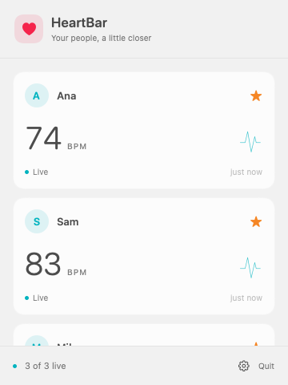
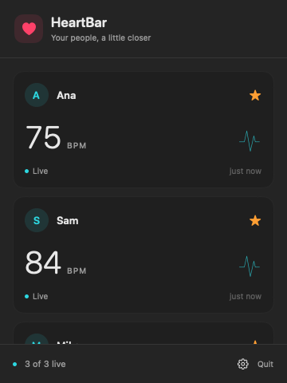
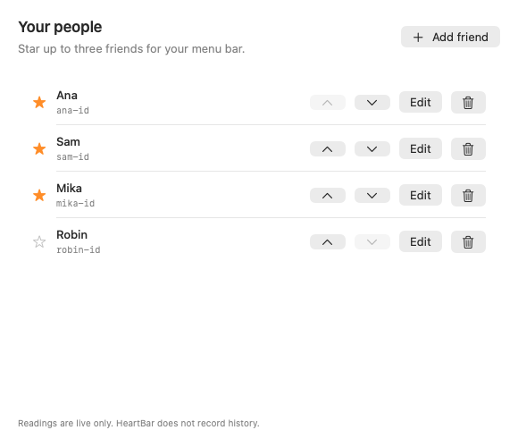
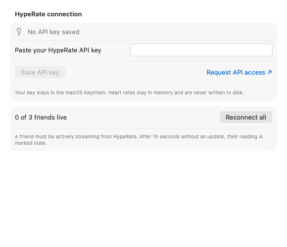

# HeartBar

A native macOS menu-bar app that keeps your friends' HypeRate heart rates close by. Requires macOS 14 or later; supports Apple Silicon and Intel. Built with SwiftUI, AppKit, Foundation, and Security, with no third-party dependencies.

## Screenshots

Native views rendered with sample friends and simulated heart rates supplied only by the screenshot tool. The popover scrolls to show everyone.

| Light appearance | Dark appearance |
| --- | --- |
|  |  |

<details>
<summary>Friends and connection settings</summary>

**Manage friends and favorites**



**Connect to HypeRate**



</details>

## Run the app

With **Xcode 16 or newer**, open `HeartBar.xcodeproj`, select the shared **HeartBar** scheme and **My Mac**, then press **⌘R**. Local builds use ad-hoc signing; no developer account is required. The app appears in the menu bar, without a Dock icon.

With recent **Apple Command Line Tools** (Swift 6+), build a local app bundle:

```sh
Scripts/build-app.sh
open build/HeartBar.app
```

Build both architectures with `Scripts/build-app.sh --universal`. The resulting app is for local use; signing, notarization, and distribution are not configured. In an already sandboxed development session, append `--disable-sandbox` to the build or test command to disable SwiftPM's nested manifest sandbox.

## Set up friends

1. Click **♥ HeartBar** in the menu bar, then the gear to open Settings.
2. In **Connection**, paste your HypeRate API key and save it. [Request HypeRate API access](https://www.hyperate.io/api) if needed. The key is stored in your macOS Keychain; the saved key is never shown again in the text field.
3. In **Friends**, add each person's name and the ID from their HypeRate app. They must be actively streaming. IDs must be unique; letters, numbers, hyphens, and underscores are accepted.
4. The first three friends are favorites. Star or unstar friends to choose up to three menu-bar readings. Use the arrows to reorder friends, **Edit** to change their name or ID, and the trash button to remove them.

## Menu bar

- Click the menu-bar item to open a scrollable popover containing everyone. Favorites appear directly in the menu bar.
- Streaming continues when the popover is closed. Open Settings or Quit from its footer. Settings has **Friends** and **Connection** tabs.
- **Live** means a valid reading arrived in the current connection within the last 15 seconds. Otherwise the menu bar and primary BPM display show **—**. The popover labels any retained value as **Last reading**, with its age. A failed connection loses its live status immediately, even when its last reading was recent.
- The app follows the system's light/dark appearance and includes labels for VoiceOver.

## Connection behavior

HeartBar implements the plan's [per-device HypeRate WebSocket reference](https://github.com/alexholzreiter/HypeRate-Websocket-API/blob/main/docs/WEBSOCKET_API.md): one `URLSessionWebSocketTask` at `wss://app.hyperate.io/ws/:deviceId`, an `hr:ID` channel join, `hr_update` messages, and a JSON `ping` every 15 seconds. An unanswered join times out after 12 seconds. The parser checks the topic against that connection's expected ID and rejects malformed, noninteger, and out-of-range BPM values.

Transient failures retry after 1, 2, 4, 8, 16, then at most 30 seconds. A valid reading resets the backoff. Credential and subscription rejections require an explicit retry after correcting the problem. Changing a HypeRate ID replaces that person's socket; removing a friend cancels it. Changing credentials replaces all sockets. Sleep cancels sockets, keepalives, pending retries, and the UI clock; wake recreates them. Generation checks ignore late events from replaced sources.

The application never logs credentials, authenticated URLs, raw provider messages, or network error descriptions. Preferences contain only friends and favorites. Heart-rate readings remain in memory; there is no recording or Events-roster import. The Keychain item uses service `com.heartbar.app.hyperate`, account `api-key`.

## Build and test

```sh
Scripts/swift.sh test
Scripts/build-app.sh --universal
Scripts/verify-ui.sh
```

The Swift Testing suite uses controlled clocks and transports. It covers message parsing and participant routing, the 15-second freshness boundary, reconnect cancellation and timeout, credential replacement/removal, startup without an API key, sleep/wake, preference compatibility, ordering, and the three-favorite limit. Test data uses a temporary preferences domain and never reads your real Keychain.

With full Xcode installed, the same tests also run with **⌘U** or:

```sh
xcodebuild -project HeartBar.xcodeproj -scheme HeartBar \
  -destination 'platform=macOS' -derivedDataPath build/DerivedData test
```

`Scripts/swift.sh` keeps compiler caches inside `.build`. It also handles the Swift Testing search-path omissions in some Command Line Tools releases. The command-line app bundle is ad-hoc signed without App Sandbox; the Xcode app target enables App Sandbox and outgoing network access.

## Project layout

- `Sources/HeartBarCore`: models, shared observable store, Keychain/preferences, protocol parsing, and the HypeRate source.
- `Sources/HeartBarApp`: status item, popover, SwiftUI cards, and settings.
- `Tests/HeartBarCoreTests`: deterministic unit tests using Swift Testing.
- `Resources`: app metadata, sandbox entitlements, and the vector-generated icon.
- `Scripts/generate-project.py`: regenerates the checked-in Xcode project and shared scheme when source files are added or removed. Uses only Python's standard library.
- `Scripts/GenerateIcon.swift`: regenerates the app icon without image dependencies.
- `Scripts/verify-ui.sh` and `Scripts/VerifyUI.swift`: render the real views and verify background updates with an injected sample source and in-memory settings. The sample source is excluded from app targets. See `VERIFICATION.md` for results and remaining interactive checks.
- `docs/screenshots`: README images. To refresh them, run `Scripts/verify-ui.sh` and copy `popover-light.png`, `popover-dark.png`, `friends.png`, and `connection.png` from `build/previews/` into this directory.

## Troubleshooting

**No live readings:** confirm the API key, check the friend's exact HypeRate ID, and have them start streaming. A successful subscription can wait indefinitely for a device to start sending; the app does not invent a reading. Use **Retry connection** on the card or **Reconnect all** in Connection.

**API key or subscription rejected:** update the key in Connection, or edit the HypeRate ID in Friends. Check your HypeRate API access, then retry. Keys are never placed in command-line arguments or source files.

**Keychain error:** unlock your login keychain and try saving again. A failed Keychain write leaves existing credentials and connections intact. Changing local code signatures may cause macOS to request Keychain access again.

**`xcodebuild` requires Xcode:** install full Xcode and select its developer directory, or use the command-line build above with Swift 6+ Command Line Tools.
